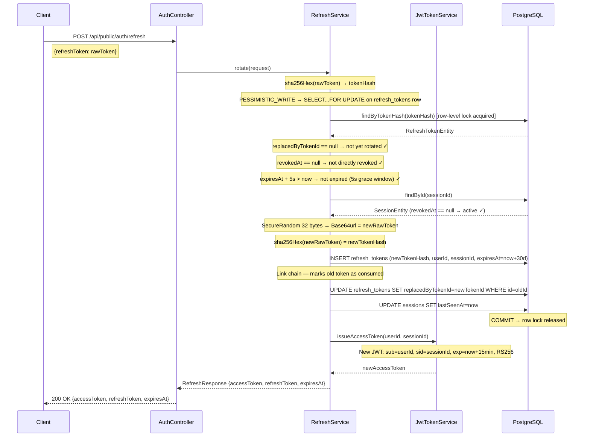
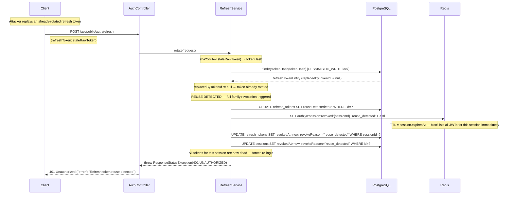
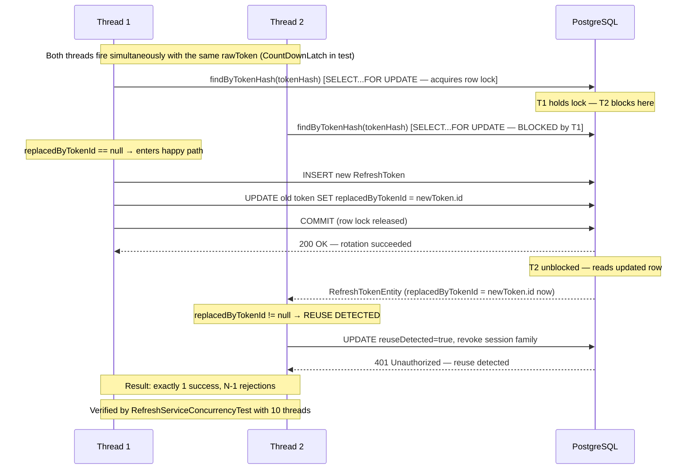
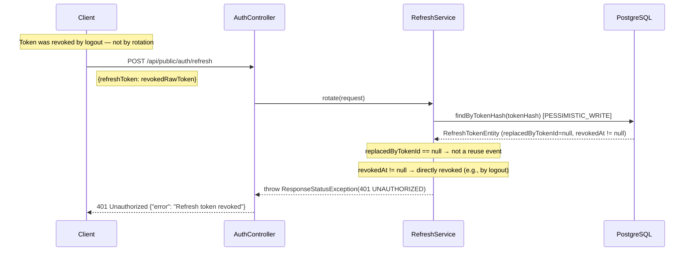
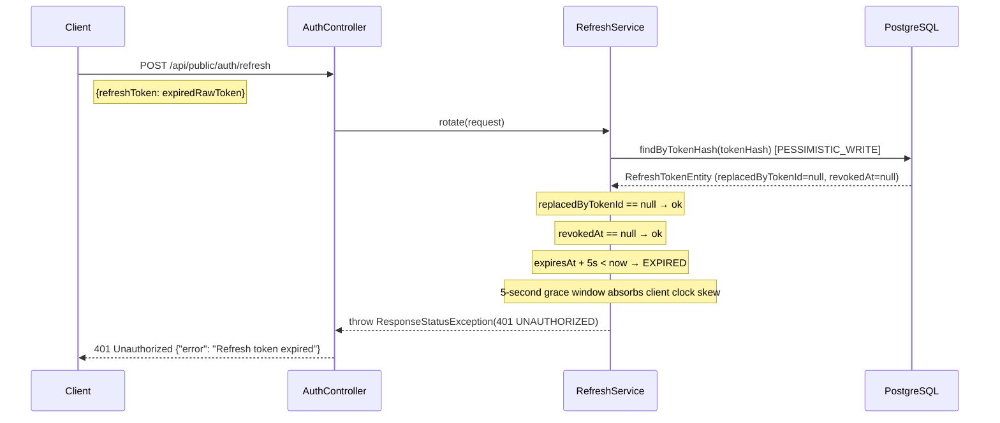
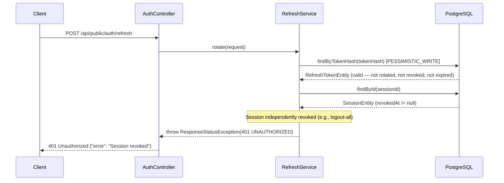

# Refresh Token — Sequence Diagrams

## Case 3a: Happy Path (Token Rotation)

## Case 3b: Reuse Detection — Stolen or Replayed Token

## Case 3c: Concurrent Race — Pessimistic Lock Serializes Threads

## Case 3d: Token Already Directly Revoked

## Case 3e: Token Expired

## Case 3f: Session Not Found or Revoked After Token Validation

