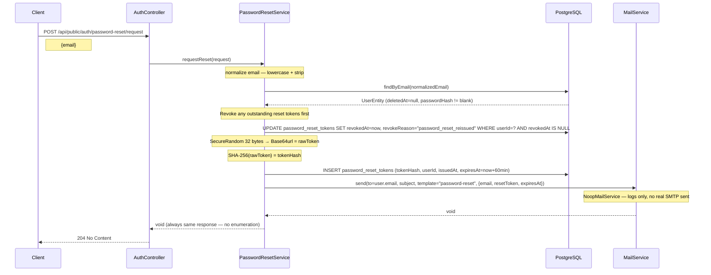
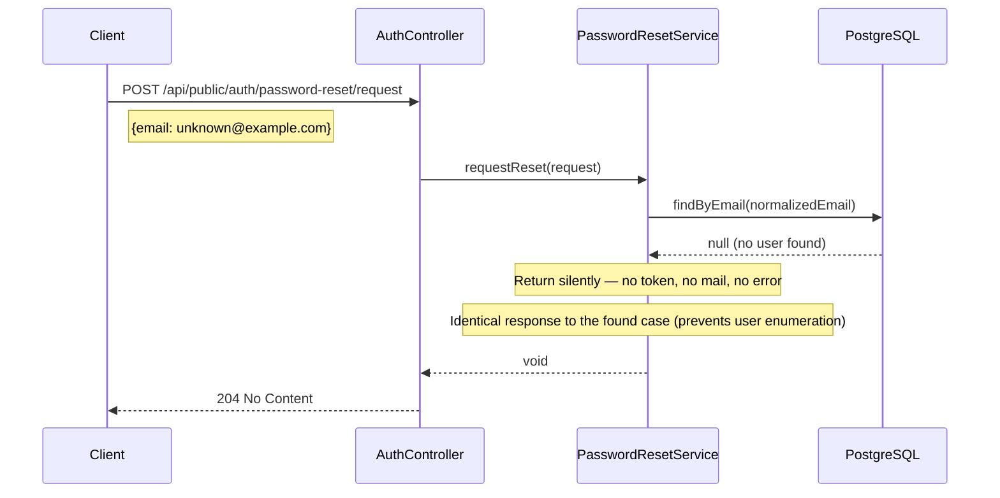
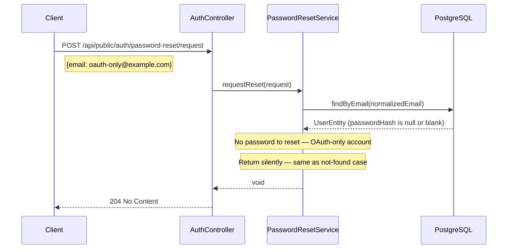
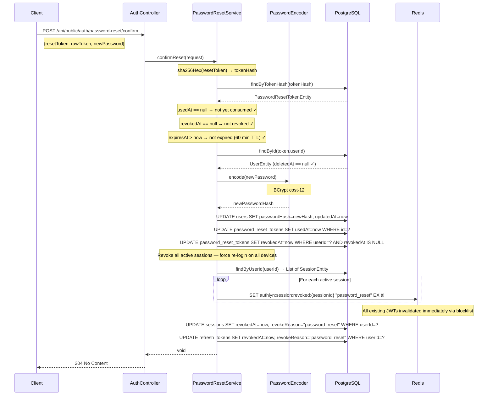
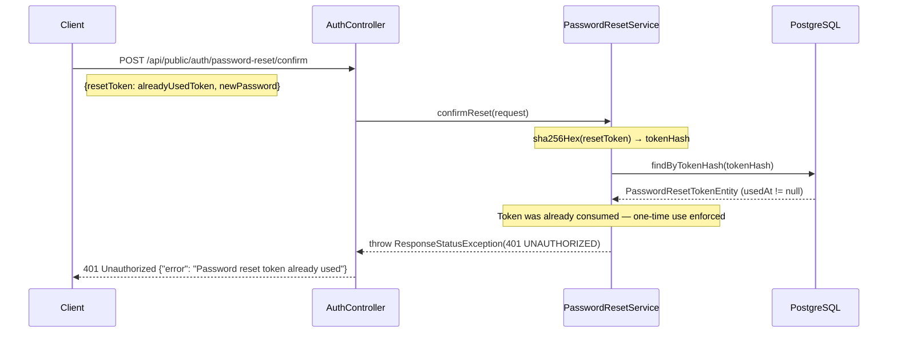
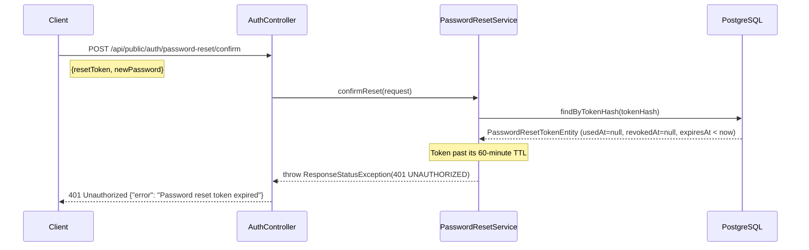
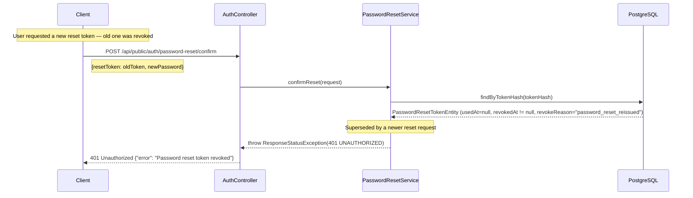

# Password Reset — Sequence Diagrams

## Case 5a: Request — Email Found (User With Password)

## Case 5b: Request — Email Not Found (Silent Anti-Enumeration)

## Case 5c: Request — OAuth-Only User (No Password Hash)

## Case 5d: Confirm — Happy Path

## Case 5e: Confirm — Token Already Used

## Case 5f: Confirm — Token Expired

## Case 5g: Confirm — Token Revoked (New Request Was Made)

