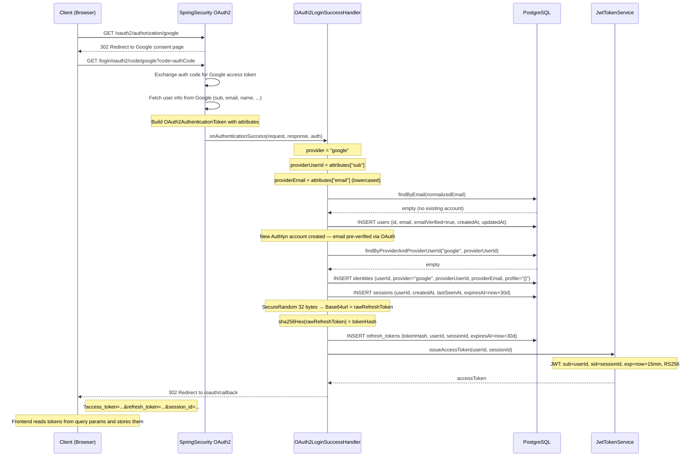
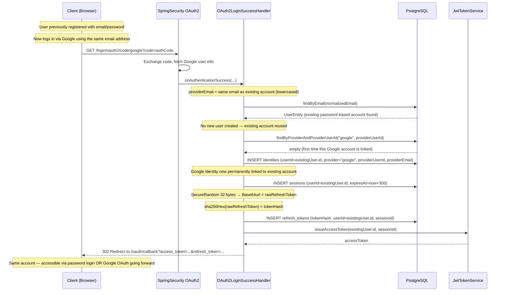
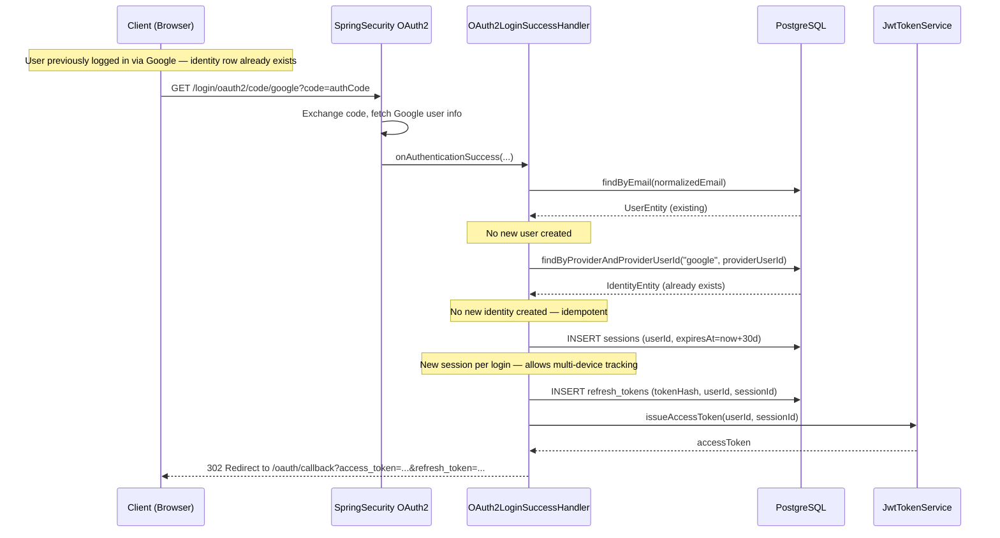

# OAuth2 Social Login — Sequence Diagrams

## Case 6a: New User (First-Time OAuth Login)

## Case 6b: Existing User — Account Linking via Email Match

## Case 6c: Returning OAuth User (Identity Already Linked)

