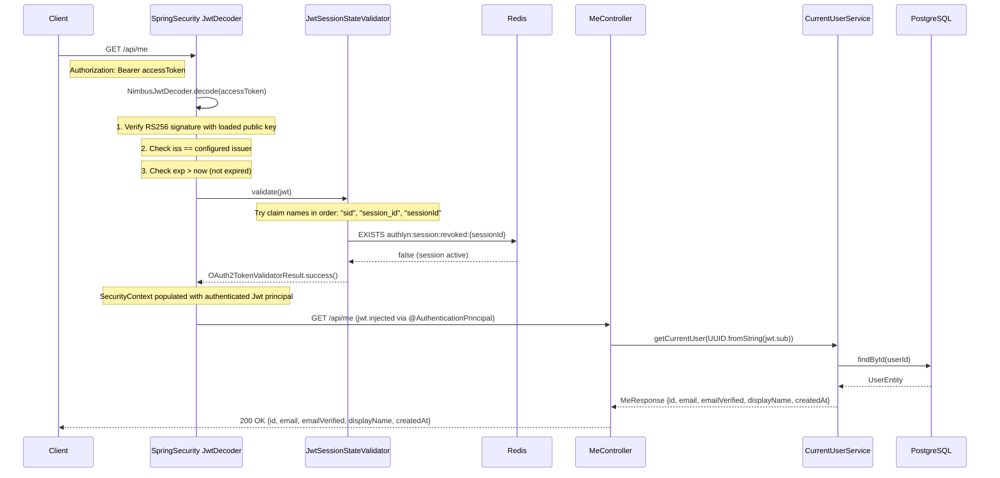
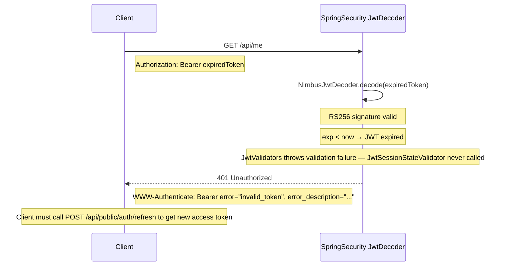
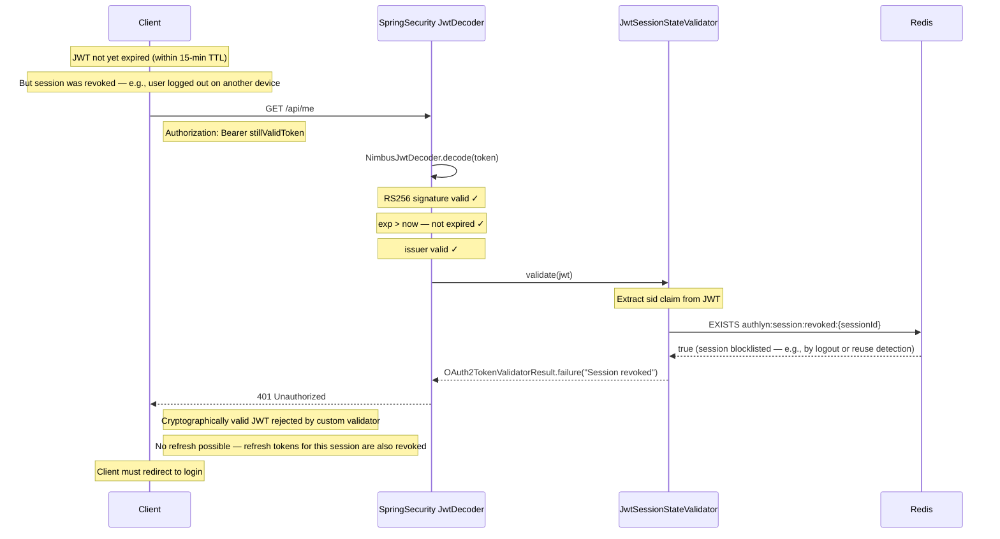
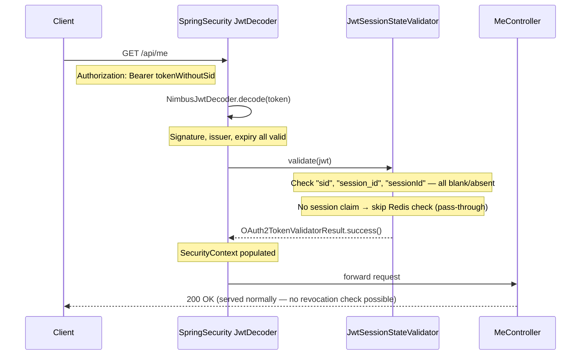
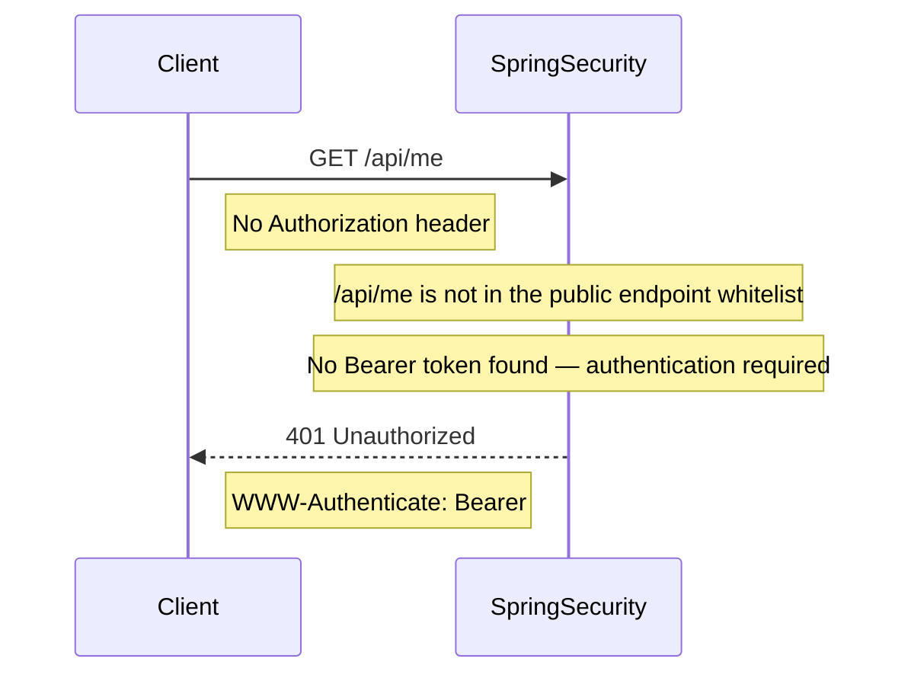

# Protected Endpoint — Sequence Diagrams

## Case 7a: Valid JWT — Success (GET /api/me)

## Case 7b: Expired JWT

## Case 7c: Revoked Session — Redis Blocklist Stops Valid JWT

## Case 7d: No sid Claim in JWT (Legacy or External Token)

## Case 7e: Missing Authorization Header

